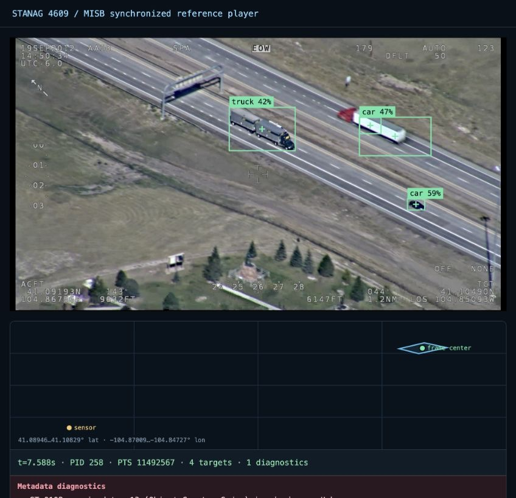
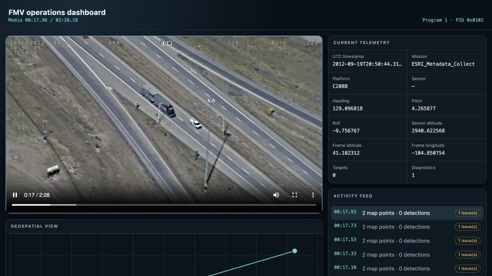

# Examples

These examples begin with a working application and then explain the relevant
API. Start with the [quickstart](QUICKSTART.md) if you have not run the generated
demo yet.

## Inspect and debug a recording

[Open the tutorial](tutorials/inspect_fmv.md)

Run the verifier against a public FMV sample, interpret its findings, open the
same stream in the player, and export its metadata.

## Create FMV from video and metadata

[Open the tutorial](tutorials/create_fmv.md)

Combine an ordinary video and ArcGIS-style metadata CSV into an MPEG transport
stream, then verify and play the result.

## Add AI detections as VMTI

[Open the tutorial](tutorials/ai_to_vmti.md)

Run multiple detector stages, attach target identity and model information, and
encode the result as ST 0903 VMTI.

## Build a video, map, and activity dashboard

[Open the tutorial](tutorials/web_dashboard.md)

Prepare browser media and a synchronized metadata timeline, then render video,
telemetry, map features, and activity in a small web application.

## Transform and fan out live KLV

[Open the tutorial](tutorials/live_fanout.md)

Process arbitrarily chunked transport data, write the transformed stream, and
publish the same timed metadata to a UI or GIS consumer.

## More runnable examples

The source distribution and [GitHub repository](https://github.com/trane293/stanag4609/tree/main/examples)
contain focused examples for:

- PyAV video and audio decoding;
- Ultralytics, ONNX Runtime, Triton, and JSON/HTTP inference;
- frame-to-KLV correlation and VMTI emission;
- the standalone HTML dashboard.

Clone the repository only when you want to run or modify those source examples.
Installing the library itself requires only PyPI.
