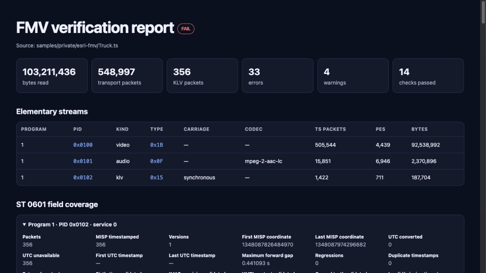
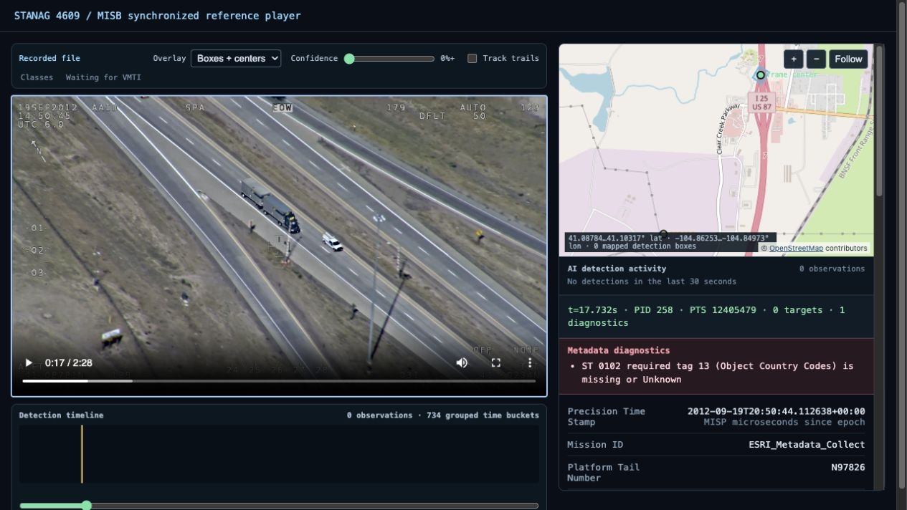

# Inspect and debug an FMV recording

In this tutorial, you will inspect an MPEG-TS recording, read its MISB
metadata, open the synchronized player, and export the geospatial timeline.
Install FFmpeg as well as the Python package because the player prepares a
browser-compatible video asset.

```console
python -m venv .venv
source .venv/bin/activate
python -m pip install stanag4609
```

## Start with a local demonstration stream

Generate a short stream so you can learn the tools without finding test data:

```console
stanag4609-demo-samples demo --duration 4
stanag4609-verify demo/stanag4609-day-demo.ts
stanag4609-player demo/stanag4609-day-demo.ts
```

The generator writes a daylight stream and a thermal stream. Both contain
H.264 video, MPEG Layer II audio, and synchronous ST 0601 metadata. Stop the
player with Ctrl-C.

## Inspect a real recording

The rest of this tutorial uses Esri's public `Truck.ts` recording. Download the
archive from the [Esri item page](https://www.arcgis.com/home/item.html?id=55ec6f32d5e342fcbfba376ca2cc409a),
extract `FMV tutorial data/Truck.ts`, and place it at
`samples/private/esri-fmv/Truck.ts`.

The fixture used for this guide is 103,211,436 bytes and has SHA-256
`8667276b2c2fb36baa089b00e3978f55893cacf6e0d8f6e6d480bb934747cc79`.
The [public fixture catalog](../PUBLIC_FIXTURES.md) records its provenance and
the helper used by repository integration tests.

Run the verifier in its default profile:

```console
stanag4609-verify "samples/private/esri-fmv/Truck.ts"
```

The first part of the report inventories the transport and its elementary
streams. The final summary for this fixture is:

```text
Result: FAIL
Input: 103211436 bytes, 548997 TS packets, 1 program(s)
Metadata: 356 KLV packet(s), 356 ST 0601, 0 ST 0903, 0 unknown
Summary: 33 error(s), 4 warning(s), 14 passed, 1 not applicable
```

The recording is still useful and playable. Its report calls out profile-level
issues such as a missing Metadata STD descriptor, missing embedded ST 0604
timestamps, and AVC or timing values outside the selected profile. If you only
need a structural ingest check, select the narrower profile:

```console
stanag4609-verify "samples/private/esri-fmv/Truck.ts" --profile structural
```

For a report that can be shared or attached to an ingest record, write the
self-contained HTML form:

```console
stanag4609-verify "samples/private/esri-fmv/Truck.ts" \
  --format html > truck-report.html
```



Use finding codes, rather than the total number of findings, when defining an
acceptance policy. The [verifier guide](../VERIFIER.md) explains profiles,
finding severity, and exit statuses.

## Follow metadata during playback

```console
stanag4609-player "samples/private/esri-fmv/Truck.ts"
```

The browser follows media PTS and shows the current Report-on-Change state, map
geometry, metadata diagnostics, and any VMTI observations found in the stream.



This recording has no VMTI observations, so the detection controls and timeline
remain empty. That makes it a useful baseline before trying the
[AI-to-VMTI tutorial](ai_to_vmti.md).

## Export the geospatial timeline

```console
stanag4609-export-geojson "samples/private/esri-fmv/Truck.ts" truck.geojsonl
stanag4609-export-esri "samples/private/esri-fmv/Truck.ts" truck.csv
```

GeoJSON is written as one feature collection per metadata update, which makes
it suitable for an incremental GIS adapter. CSV provides an ArcGIS FMV
sidecar-compatible boundary. Neither command modifies the input file.

The same timeline is available in Python:

```python
from stanag4609.player import scan_transport_file

timeline = scan_transport_file("samples/private/esri-fmv/Truck.ts")
print(f"metadata samples: {len(timeline.samples)}")
for sample in timeline.samples[:3]:
    latitude = sample.fields.get("Sensor Latitude", {}).get("value")
    longitude = sample.fields.get("Sensor Longitude", {}).get("value")
    print(sample.time_seconds, latitude, longitude)
```

Use `scan_transport_file()` for presentation and analytics. Use the verifier
when you need a standards or ingest decision.
